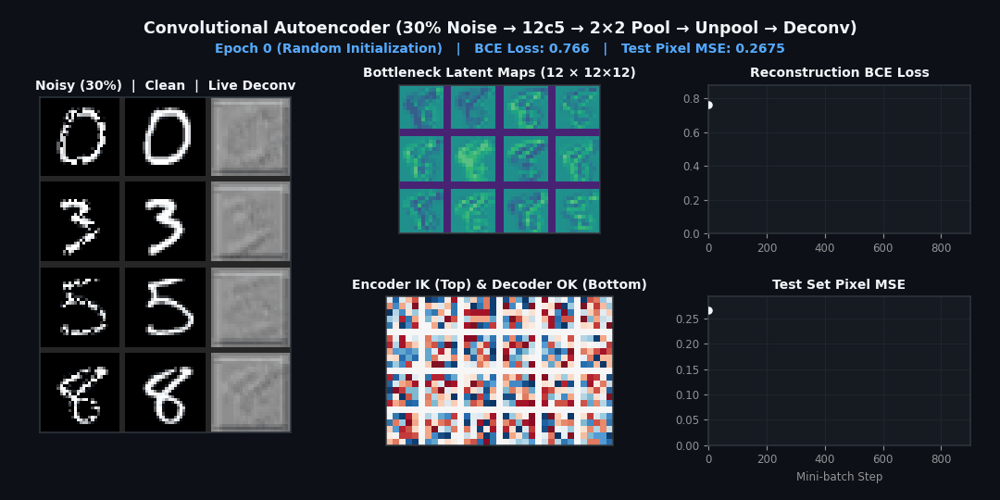
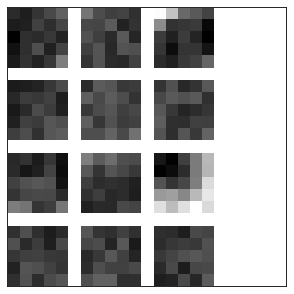

# Convolutional Autoencoder (`CAE`)

Pure-NumPy Convolutional Autoencoder (`CAE`) and Stacked CAE (`SCAE`) completing the 5th module left unfinished in the 2016 port. Uses `valid` encoder convolutions, `2×2` spatial mean pooling, `2×2` nearest unpooling, and `full` decoder transposed convolutions with optional denoising input masking (`InputZeroMaskedFraction`) and `bce`/`mse` reconstruction loss.

## Training Animation & Live Deconv Reconstruction



**What is shown inside the animation:**
- **Left (`Noisy 30% | Clean | Live Deconv`):** Watch `30%`-corrupted digits (`0, 3, 5, 8`) pass through `12×(5×5)` encoding + `2×2` spatial pooling and reverse-map cleanly back to crisp `28×28` reconstructions (`Test Pixel MSE: 0.0117`).
- **Middle Top (`Bottleneck Latent Maps 12 × 12×12`):** Live `12×12` pooled latent activations for digit `'8'`, showing specialized filters responding to loops and diagonal crossings.
- **Middle Bottom (`Encoder IK & Decoder OK`):** Side-by-side `5×5` encoder filters (top rows) and decoder reconstruction filters (bottom rows).
- **Right (`Reconstruction BCE Loss` & `Test Pixel MSE`):** Smooth monotonic convergence (`0.267 → 0.0117` MSE).

## Static Encoder Filters (`output/`)



## Files in `CAE/`

| File | Purpose |
| :--- | :--- |
| [`ConvolutionalAutoEncoder.py`](ConvolutionalAutoEncoder.py) | `CAE` and `SCAE` classes with `4×` Glorot sigmoid encoder init and momentum state |
| [`caeup.py`](caeup.py) | Encoder pass: optional denoising masking, `valid` 2D conv, `sigm`, and `S×S` pooling |
| [`caedown.py`](caedown.py) | Decoder reverse-map pass: `S×S` unpooling + `full` 2D conv + `sigm`/`linear` output |
| [`caeff.py`](caeff.py) | Combined encode-decode pass and `bce`/`mse` loss evaluation |
| [`caebp.py`](caebp.py) | Exact analytical backpropagation for `IK`, `B`, `OK`, `C` through unpool/pool & conv layers |
| [`caeapplygrads.py`](caeapplygrads.py) | Momentum SGD parameter updates |
| [`caetrain.py`](caetrain.py) | `caetrain` and greedy layer-wise `scaetrain` loops |
| [`caetest.py`](caetest.py) | Pixel MSE evaluation (`caetest`) and `caeunfoldtocnn` transfer into [`CNN`](../CNN/README.md) |

## Run & Verification

```bash
python tests/test_example_CAE.py
```

- **Gradient Check:** Verified all analytical gradients (`dIK`, `dOK`, `dB`, `dC`) against central finite differences (`< 1e-5` relative error) for both `bce` (`scale=2`) and `mse` (`scale=1`, multi-channel) configurations.
- **Denoising CAE (`12c5-2s`, 30% noise, 3 epochs):** Test pixel MSE dropped from `0.267172` to `0.011672`.
- **Stacked CAE (`6c5-2s → 12c5-2s`) unfolded to CNN:** Reached `0.1800` test error in 1 supervised epoch on 30k samples.
