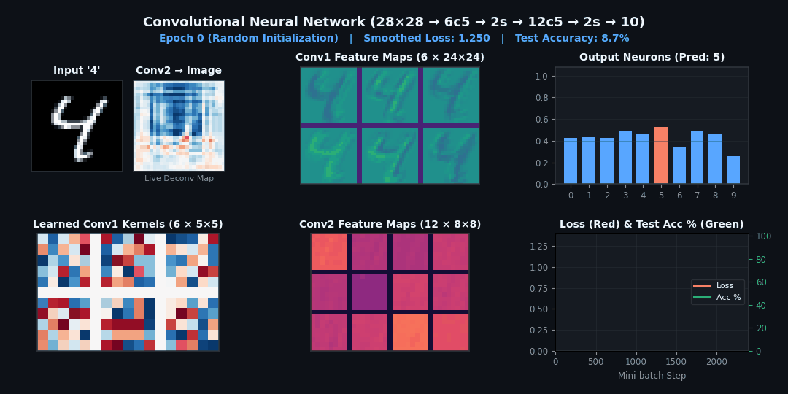
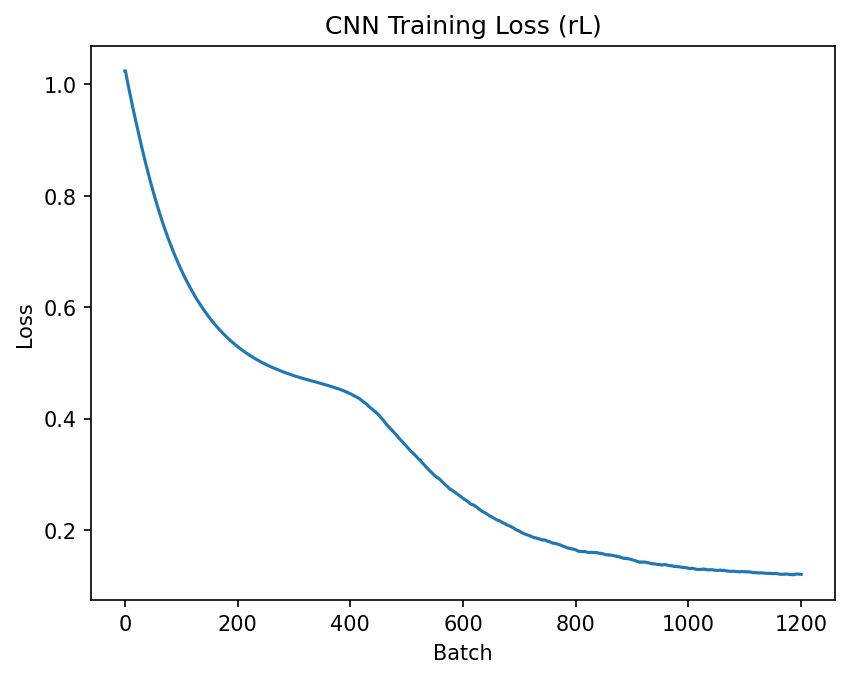

# Convolutional Neural Network (`CNN`)

Pure-NumPy convolutional network implementing LeNet-style alternating `ConvolutionalLayer` and average-pooling `ScaleLayer` blocks (`28×28 → 6c5 → 2s → 12c5 → 2s → 10`) backed by vectorized `sliding_window_view` + BLAS matrix multiplication ([`util/conv2d.py`](../util/conv2d.py)).

## Training Animation & Live Deconv Reverse Map



**What is shown inside the animation:**
- **Top-Left (`Input '4'` & `Conv2 → Image`):** Live transposed-convolution reverse projection mapping active `Conv2` (`12×8×8`) features back through `Pool1` unpooling and `Conv1ᵀ` to `28×28` pixel space.
- **Bottom-Left (`Learned Conv1 Kernels`):** All `6` `5×5` filters evolving from random noise into oriented edge and stroke detectors.
- **Middle (`Conv1 & Conv2 Feature Maps`):** Live intermediate activations across `Conv1` (`6 × 24×24`) and `Conv2` (`12 × 8×8`) for the probe digit `'4'`.
- **Right (`Output Neurons` & `Loss / Test Accuracy`):** Output scores across classes `0..9` alongside smoothed loss (`0.087`) and test accuracy (`90.0%` after 2 epochs).

## Static Training Loss (`output/`)



## Files in `CNN/`

| File | Purpose |
| :--- | :--- |
| [`ConvolutionalNeuralNetwork.py`](ConvolutionalNeuralNetwork.py) | `CNN` architecture setup (`6c5-2s-12c5-2s`) and Xavier kernel initialization |
| [`Layers.py`](Layers.py) | `InputLayer`, `ConvolutionalLayer`, and `ScaleLayer` definitions |
| [`cnnff.py`](cnnff.py) | Forward pass (`valid` 2D convolutions, `sigm`, `2×2` mean subsampling, flatten + `ffW`) |
| [`cnnbp.py`](cnnbp.py) | Backpropagation through output layer, `ScaleLayer` upsampling, and `full` kernel transpose convs |
| [`cnnapplygrads.py`](cnnapplygrads.py) | SGD updates for kernels `K`, biases `B`, and dense head `ffW` / `ffB` |
| [`cnntrain.py`](cnntrain.py) / [`cnntest.py`](cnntest.py) | Mini-batch training loop and MNIST test accuracy evaluation |

## Run

```bash
python tests/test_example_CNN.py
```

Observed 1-epoch MNIST test error (`batchsize=50`, `alpha=1`): `0.1105` (`30.4 s`).
