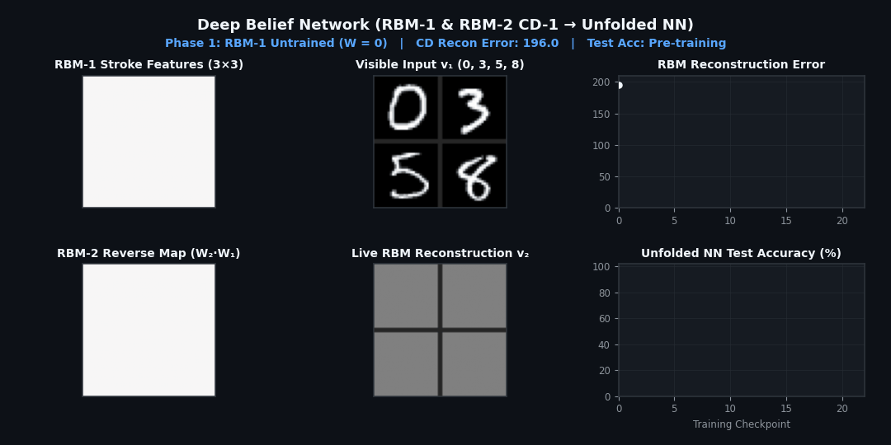
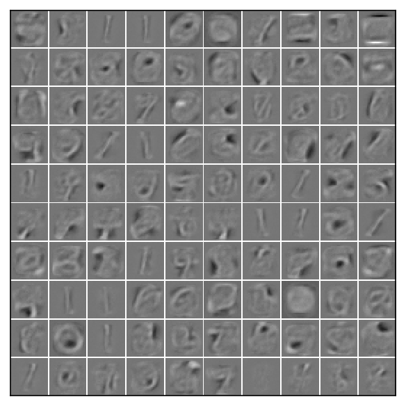

# Deep Belief Network (`DBN`)

Pure-NumPy greedy layer-wise Restricted Boltzmann Machines (`RBM`) trained via Contrastive Divergence (`CD-1`) and unfolded via [`dbnunfoldtonn.py`](dbnunfoldtonn.py) into a supervised feedforward [`NN`](../NN/README.md).

## Training Animation & Live RBM Reconstruction



**What is shown inside the animation:**
- **Left (`RBM-1 Stroke Features` & `RBM-2 Reverse Map`):** Top shows `RBM-1` weights (`28×28`) emerging from zeros into localized digit strokes; bottom projects deeper `RBM-2` units back into pixel space via `W₂ · W₁`.
- **Middle (`Visible Input v₁` & `Live RBM Reconstruction v₂`):** Shows live Contrastive Divergence Gibbs reconstructions (`v₁ → h₁ → v₂`) sharpening from gray haze into crisp digits (`0, 3, 5, 8`).
- **Right (`RBM Reconstruction Error` & `Unfolded NN Accuracy`):** Tracks unsupervised CD-1 reconstruction error (`~196 → 7.9`) followed by supervised fine-tuning accuracy reaching `92.4%`.

## Static RBM Weights (`output/`)



## Files in `DBN/`

| File | Purpose |
| :--- | :--- |
| [`DeepBeliefNetwork.py`](DeepBeliefNetwork.py) | `RBM` and `DBN` parameter initialization (`W`, `B`, `C` and velocities) |
| [`rbmtrain.py`](rbmtrain.py) | Contrastive Divergence (`CD-1`) training with stochastic binary hidden/visible sampling |
| [`rbmup.py`](rbmup.py) | Upward probability propagation between stacked RBM layers |
| [`dbntrain.py`](dbntrain.py) | Greedy layer-wise pre-training across all RBMs in the DBN |
| [`dbnunfoldtonn.py`](dbnunfoldtonn.py) | Unfolds pre-trained RBM weights `W` and hidden biases `C` into an `NN` classifier |

## Run

```bash
python tests/test_example_DBN.py
```

Observed results (`tests/test_example_DBN.py`): RBM-1 reconstruction error `67.60`, RBM-2 reconstruction error `10.18`, unfolded NN test error `0.0789`.
