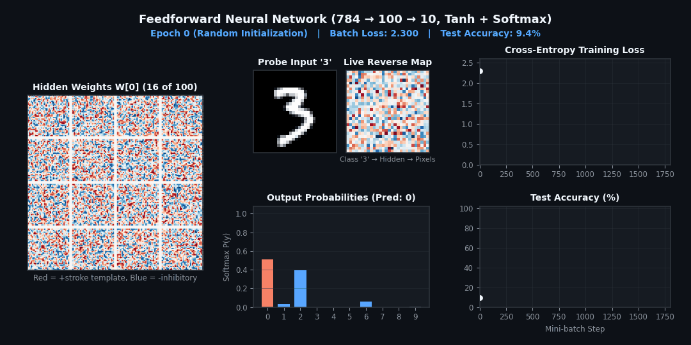
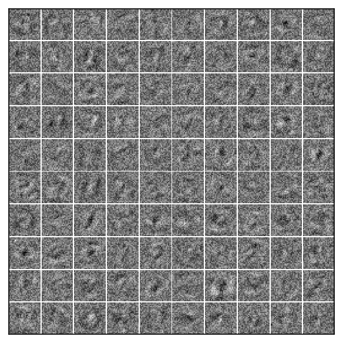

# Feedforward Neural Network (`NN`)

Pure-NumPy multilayer perceptron supporting `tanh_opt` and `sigm` hidden activations, `sigm` / `linear` / `softmax` output layers, momentum SGD, L2 weight decay, and inverted-scaling dropout.

## Training Animation & Live Reverse Map



**What is shown inside the animation:**
- **Left (`Hidden Weights W[0]`):** `16` of the `100` hidden units (`28×28` reshaped weight templates) evolving from random initialization into stroke detectors.
- **Middle Top (`Probe Input '3'` vs `Live Reverse Map`):** Projects the hidden-layer contributions for class `'3'` (`(A[1] ⊙ W[1][3]) · W[0]`) back into `28×28` pixel space to highlight which pixels support the `'3'` prediction.
- **Middle Bottom (`Output Probabilities`):** Live `10`-class softmax probability distribution on the probe digit.
- **Right (`Loss & Accuracy`):** Cross-entropy loss dropping smoothly from `~2.5` to `0.075` while test accuracy climbs to `91.9%` over 6 epochs (`batchsize = 1000`, L2 decay `1e-4`).

## Static Visualization (`output/`)



## Files in `NN/`

| File | Purpose |
| :--- | :--- |
| [`NeuralNetwork.py`](NeuralNetwork.py) | `NN` class initialization, hyperparameters, and Xavier-scaled weights `W` |
| [`Collections.py`](Collections.py) | `Training`, `Validity`, and `Loss` tracking structures |
| [`nnff.py`](nnff.py) | Feedforward pass with bias injection, dropout masking, and `sigm`/`linear`/`softmax` output |
| [`nnbp.py`](nnbp.py) | Backpropagation of deltas and weight gradients `DW` |
| [`nnapplygrads.py`](nnapplygrads.py) | Momentum SGD updates with optional L2 regularization |
| [`nntrain.py`](nntrain.py) | Mini-batch training loop with optional validation evaluation and step callback |
| [`nneval.py`](nneval.py) | Full-batch training/validation loss and misclassification evaluation |
| [`nnpredict.py`](nnpredict.py) / [`nntest.py`](nntest.py) | Inference and test error rate computation |
| [`nnupdatefigures.py`](nnupdatefigures.py) | Interactive Matplotlib live training plotter |

## Run

```bash
python tests/test_example_NN.py
```

Observed MNIST test errors (`tests/test_example_NN.py`): `0.0497` (Tanh, 5 ep), `0.0722` (L2), `0.0890` (Dropout), `0.0836` (Sigmoid), `0.0849` (Softmax), `0.0646` (Softmax + Validation, 5 ep).
