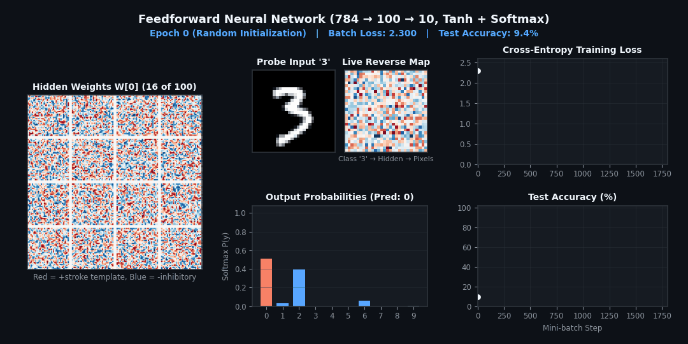
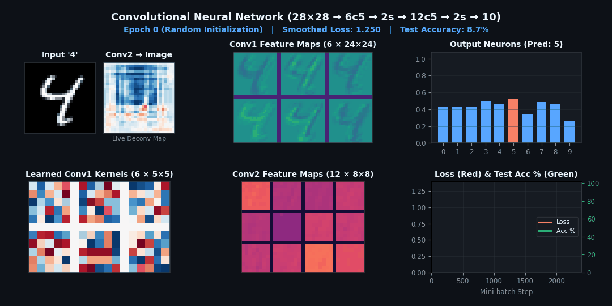
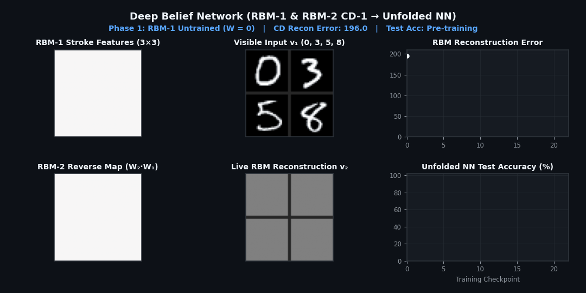
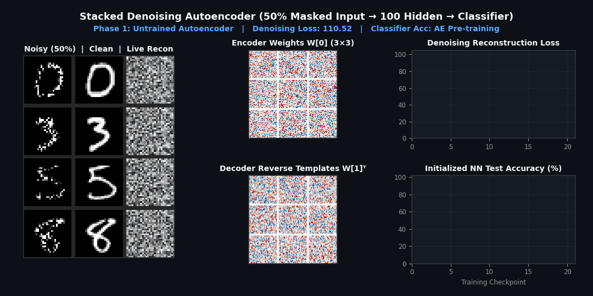
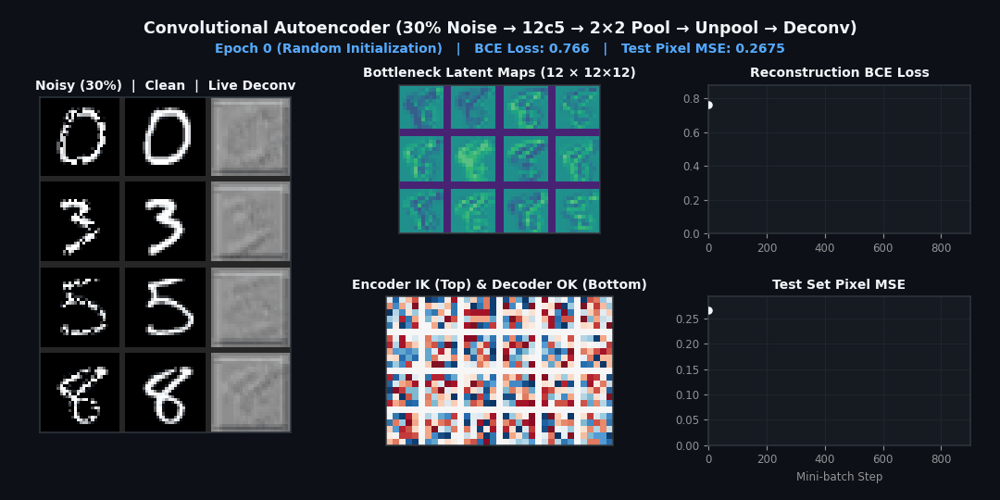

> **History (2016 → 2026):** The original 2016 README is preserved verbatim below. Jump to the [2026 Update (Completed CAE, Training Animations & Python 3.12)](#2026-update-ten-years-later) or [Contributors](#contributors).

# DeepNeuralNetworks
Pure NUMPY based deep neural network implementation.
Python based Deep Neural Network code set - A "copy-paste" effort from Matlab  (rasmusbergpalm matlab code) to Python.
I have been learning about Python and Deep Learning. To fully understand the inners workings of Deep Neural Networks, 
I decided to translate the Matlab code from https://github.com/rasmusbergpalm/DeepLearnToolbox to Python. Please note any
improvements/suggestions are highly welcomed.

I have completed the code for the following

		1. NN
		2. CNN
		3. DBN
		4. SAE
		5. CAE - This seems to be incomplete from the original source. But will try to implement it once I understand more about it.
		
Note you are free to update this code and submit fixes. It is a code purely written for educational purpose. 
If you are stuck at hefty packages like caffe, cuda, torch , tensorflow and feel lost with deep neural networks, 
then the matlab version of the code or this python version is where you should start.

Please note that I have tried as much as possible to produce a "Copy-Paste" version of the code, despite that, 
you will find many code differences. Like handling of overlfows, logs, exponentials and classes. 

I hope you will enjoy using the code as much as I enjoyed translating it :)

# Note on code Translations
I have tried my best to keep the code in a more understanable way. I know there are various functions that could have been done far better and clean in a more pythonic way, but that does not serve the purpose of a clear code understanding. I have also tried my best to develop the code that is close to matlab in terms of accuracy.

        1. Random states for both Python and Matlab have been set using the 'twister' algorithm. This is important to attain correct accuracies.	
        2. For debugging the code, I have added a single line of code that runs Matlab/Pyhon in a sequential way.
        3. Collections in NN module are data structures used by the different classes in NN. These are helpful while writing clean code
 	 
# Dependencies/Dev Tools/Platform
	1- Anaconda 4.1.1
	2- PyDev
	3- Eclipse Luna
	4- Windows 10
	5- Matlab 2015a
	6- Python 3.5

# Accuracy comparison (Python vs Matlab)
It is evident that that both are close from following tables that accuracies are very close


With epochs = 1,  batches = 100, total batches = 600

(Full Batch Errors) 

| Neural Networks        | Python          | Matlab   |
| ---------------------- |:---------------:| --------:|
| Tanh                   | 0.071304        | 0.070366 | 
| L2 Decay		         | 0.066278        | 0.063632 | 
| Dropout		         | 0.071164        | 0.070079 | 
| Sigmoid		         | 0.067494        | 0.067301 | 
| Softmax		         | 0.246335        | 0.385170 |


With epochs = 1,  and batches = 50, total batches = 1200  

| CNN                            | Python          | Matlab   |
| ------------------------------ |:---------------:| --------:|
| 				                 | 0.1256          | 0.1229   |
|                                |                            |
| Network Structure              | 
|--------------------------------|
| C: OuputMaps=6, kernel size=5  |
| S: Scale =2        			 |
| C: OuputMaps=12, kernel size=5 | 
| S: Scale =2                    |  

With epochs = 1,  and batches = 100, total batches = 600  

| DBN                            | Python        | Matlab     |
| ------------------------------ |:-------------:| ----------:|
| size = 100	                 |    Reconstruction Error    |	
|                                |  66.15        | 66.2       |
| size = (100,100)               |    Reconstruction Error    |
|                                |  10.93        | 10.97      | 
| Unfolded to NN                 |    Full Batch Error        |	 					             
|								 |	0.0667		 | 0.067      |	


With epochs = 1,  and batches = 100, total batches = 600  

(Full Batch Errors)

| SAE (DE-NOISING)               | Python        | Matlab     |
| ------------------------------ |:-------------:| ----------:|
| size = (784,100,10)            |  13.46        | 12.70	  |                                 
|							     |				 |			  |	    	 					             
| Using FFNN to initialize NN    |  0.13         | 0.12       |

---

## 2026 Update: Ten Years Later

Ten years after starting this repository in 2016 while learning Python and deep learning, we revisited the codebase in November 2026 to:

1. **Finish the incomplete #5 algorithm (`CAE/`)** — implemented a pure-NumPy Convolutional Autoencoder (`CAE`) and greedy layer-wise Stacked Convolutional Autoencoder (`SCAE`) with `2×2` pooling/unpooling, denoising input masking, analytical backpropagation (finite-difference gradient verified to `< 1e-5` relative error), and `caeunfoldtocnn` pre-training transfer into `CNN`.
2. **Visualize what happens inside every network during training** — added animated training GIFs and static plots in [`output/`](output/) showing evolving receptive fields, convolutional kernels, intermediate feature maps, and **live reverse mappings back to `28×28` pixel space**.
3. **Unify MNIST data loading without MATLAB** — replaced `mnist_uint8.mat` and `importMat.py` with [`data/download_mnist.py`](data/download_mnist.py) and [`data/mnist.py`](data/mnist.py), which fetch official MNIST IDX archives and cache them in `data/mnist.npz`.
4. **Modernize for Python 3.12 & fix 2016 bugs** — replaced deprecated `np.float` / float indices, removed hardcoded `E:\RnD\...` Eclipse paths, fixed `CNN/cnnbp.py` (`D[i]` → `D[j]`), `CNN/cnnapplygrads.py` (`ffb` → `ffB`), `NN/nnff.py` softmax (`argmax` → `amax`), and accelerated 2D batch convolutions via [`util/conv2d.py`](util/conv2d.py) (~13× faster `CNN` epoch).
5. **Add modern tooling** — added [`requirements.txt`](requirements.txt), [`.vscode/launch.json`](.vscode/launch.json), and an end-to-end runner [`scripts/run_all.py`](scripts/run_all.py).

---

### Inside the Networks: Training Animations

Each animation is generated directly from the pure-NumPy training loops using [`scripts/generate_training_gifs.py`](scripts/generate_training_gifs.py), pairing internal feature maps and weights with live reverse projections back to image space.

#### 1. Feedforward Neural Network (`NN`) — [`NN/README.md`](NN/README.md)
*Watches `W[0]` hidden stroke receptive fields emerge, projects class `'3'` back through hidden activations into `28×28` pixel space, and tracks softmax probabilities and cross-entropy convergence.*



#### 2. Convolutional Neural Network (`CNN`) — [`CNN/README.md`](CNN/README.md)
*Displays learned `5×5` `Conv1` kernels, `Conv1` (`6×24×24`) and `Conv2` (`12×8×8`) feature maps, and a live transposed-convolution reverse map (`Conv2 → Pool1 → Conv1ᵀ → 28×28`) alongside output scores.*



#### 3. Deep Belief Network (`DBN`) — [`DBN/README.md`](DBN/README.md)
*Visualizes Contrastive Divergence (CD-1) learning `RBM-1` stroke detectors, deep `RBM-2` units reverse-mapped via `W₂·W₁`, live Gibbs fantasy reconstructions (`v₁ → h₁ → v₂`), and unfolded NN fine-tuning.*



#### 4. Stacked Denoising Autoencoder (`SAE`) — [`SAE/README.md`](SAE/README.md)
*Shows 50% masked noisy digits reconstructed live back to clean digits alongside evolving encoder templates `W[0]` and decoder reverse templates `W[1]ᵀ`, followed by classifier fine-tuning.*



#### 5. Convolutional Autoencoder (`CAE`) — [`CAE/README.md`](CAE/README.md) *(Completed in 2026)*
*Demonstrates 30% denoising reconstruction through `12×(5×5)` encoder convolution → `2×2` pooling → `12×(12×12)` bottleneck maps → `2×2` unpooling → `5×5` transposed decoder convolution.*



---

### 2026 Verification Results (Python 3.12.7 + NumPy 1.26.4 on Unified MNIST)

All 5 verification suites and visualization generators executed end-to-end via `python scripts/run_all.py`:

| Module | Test Script | Key Configuration | Observed Result |
| :--- | :--- | :--- | :--- |
| **NN** | [`tests/test_example_NN.py`](tests/test_example_NN.py) | Tanh (5 ep) / L2 / Dropout / Sigm / Softmax / Val | Test errors: `0.0497` (tanh), `0.0722` (L2), `0.0890` (dropout), `0.0836` (sigm), `0.0849` (softmax), `0.0646` (softmax+val) |
| **CNN** | [`tests/test_example_CNN.py`](tests/test_example_CNN.py) | `6c5-2s-12c5-2s`, 1 epoch, batch 50 | `0.1105` test error (`30.4 s`) |
| **DBN** | [`tests/test_example_DBN.py`](tests/test_example_DBN.py) | `100-100` RBMs (CD-1) → Unfolded NN | RBM recon error: `67.60` / `10.18`; NN test error: `0.0789` |
| **SAE** | [`tests/test_example_SAE.py`](tests/test_example_SAE.py) | `784-100-784` (50% mask) → FFNN (2 ep) | AE train err: `11.05`; NN test error: `0.0718` |
| **CAE** | [`tests/test_example_CAE.py`](tests/test_example_CAE.py) | Grad check + `12c5-2s` Denoising CAE + `SCAE→CNN` | Gradients `< 1e-5` rel err; pixel MSE `0.2672 → 0.0117`; unfolded CNN `0.1800` (30k, 1 ep) |

---

### Quick Start (2026)

```bash
pip install -r requirements.txt

# 1. Download official MNIST and build unified data/mnist.npz (also auto-runs on first import)
python data/download_mnist.py

# 2. Run all 5 models end-to-end and regenerate output/ animations & plots
python scripts/run_all.py
```

Or run individual examples (`tests/test_example_NN.py`, `CNN`, `DBN`, `SAE`, `CAE`) directly from VS Code using the configurations in [`.vscode/launch.json`](.vscode/launch.json).

### Output Artifacts (`output/`)

Every visualization—animated training GIFs (`*_training.gif`), final training dashboards (`*_training_final.png`), and per-test filter/loss figures (`nn_receptive_fields.png`, `cnn_training_loss.png`, `dbn_rbm_weights.png`, `sae_encoder_weights.png`, `cae_encoder_filters.png`)—is saved to [`output/`](output/).

---

### Contributors

- **wajihullahbaig** — Original 2016 pure-NumPy translation of `NN`, `CNN`, `DBN`, and `SAE` from `DeepLearnToolbox`.
- **Gemini / Google Antigravity** (`200291788+gemini-code-assist@users.noreply.github.com`) — 2026 completion of `CAE`/`SCAE`, Python 3.12 & NumPy modernization, vectorized 2D convolution, unified MNIST loader, VS Code launch configs, and training/reverse-map GIF visualizations.
