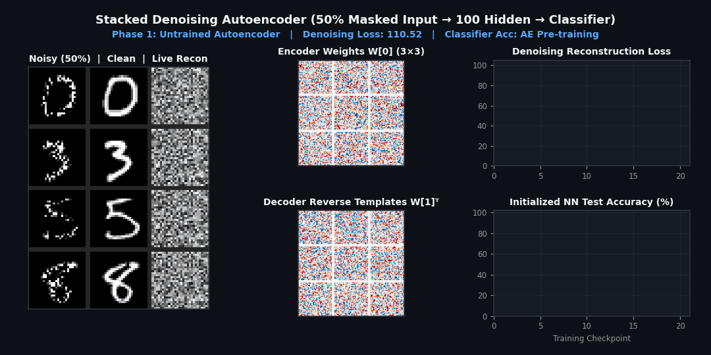
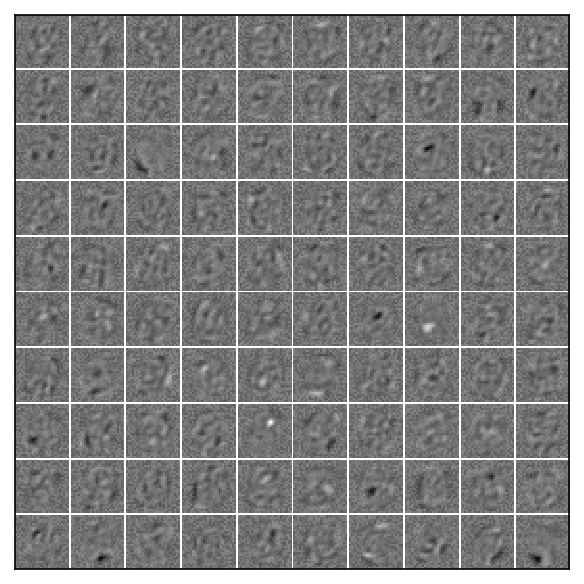

# Stacked Denoising Autoencoder (`SAE`)

Pure-NumPy greedy layer-wise denoising autoencoder built atop [`NN`](../NN/README.md), where `InputZeroMaskedFraction = 0.5` randomly zeros half the input pixels during training so hidden units learn robust stroke representations that transfer to a supervised classifier.

## Training Animation & Live Denoising Reconstruction



**What is shown inside the animation:**
- **Left (`Noisy 50% | Clean | Live Recon`):** Live forward denoising reconstructions of `50%`-corrupted MNIST digits (`0, 3, 5, 8`), watching missing strokes fill back in cleanly.
- **Middle (`Encoder Weights W[0]` & `Decoder Reverse Templates W[1]ᵀ`):** Shows encoder receptive fields and decoder pixel templates co-adapting as stroke detectors.
- **Right (`Denoising Loss` & `Initialized NN Accuracy`):** Tracks AE reconstruction MSE dropping (`~114 → 7.30`) followed by fine-tuned classifier accuracy climbing to `89.3%`.

## Static Encoder Weights (`output/`)



## Files in `SAE/`

| File | Purpose |
| :--- | :--- |
| [`StackedAutoEncoder.py`](StackedAutoEncoder.py) | `SAE` container constructing symmetric `[d_in, d_hidden, d_in]` autoencoders |
| [`saetrain.py`](saetrain.py) | Greedy layer-wise autoencoder pre-training propagating hidden representations |

## Run

```bash
python tests/test_example_SAE.py
```

Observed results (`tests/test_example_SAE.py`): AE full-batch train error `11.05`, initialized FFNN test error `0.0718` (2 fine-tune epochs).
